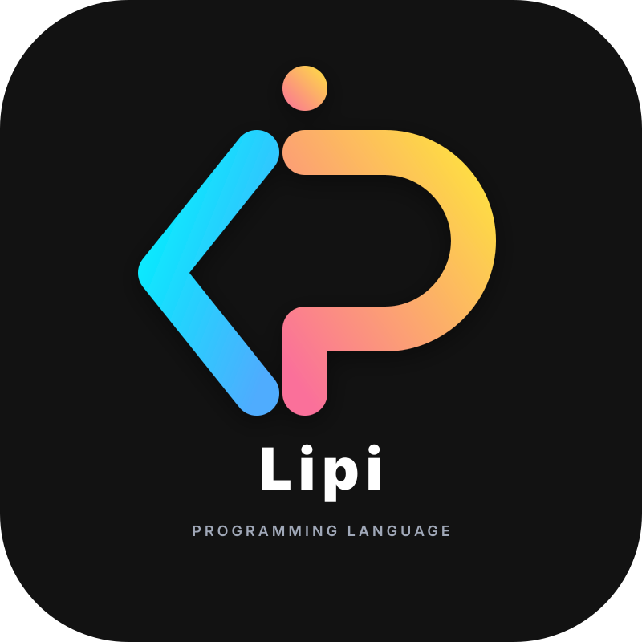

<div align="center">



# 👑 লিপি (LiPi) সার্বভৌম প্রোগ্রামিং ভাষা
### *পাইথনের চেয়ে সহজ। সি/রাস্টের মতো দ্রুত। ১০০% সেলফ-হোস্টিং ও জিরো-ডিপেন্ডেন্সি।*

**লিপি প্রথম ১.০.০ (Lipi First 1.0.0 — সার্বভৌম রিলিজ)**  
*বিশ্বের প্রথম দ্বিভাষিক সিস্টেম প্রোগ্রামিং ভাষা যা সরাসরি নেটিভ সিলিকন মেশিন কোডে কম্পাইল হয়।*

[](#১০০-সার্বভৌম-অবস্থা)
[](#আর্কিটেকচার)
[](docs/ARCHITECTURE.md)
[-brightgreen.svg)](tests/)
[](README.md)
[](LICENSE)

🌐 **ভাষা সংস্করণ:** [**English**](README.md) • **বাংলা সংস্করণ**

[বাংলা হ্যান্ডবুক](docs/HANDBOOK_BN.md) • [English Handbook](docs/HANDBOOK_EN.md) • [আর্কিটেকচার](docs/ARCHITECTURE.md) • [কোডবেস ম্যাপ](docs/CODEBASE_MAP.md) • [ইউনিভার্স ঘোষণাপত্র](docs/LIPI_UNIVERSE.md) • [উদাহরণসমূহ](examples/README.md) • [স্ট্যান্ডার্ড লাইব্রেরি](docs/STANDARD_LIBRARY.md)

</div>

---

## 🌟 লিপি কী?

**লিপি (LiPi)** হলো সম্পূর্ণ নিজস্ব নীতি ও স্বকীয়তায় তৈরি একটি দ্বিভাষিক সাধারণ-উদ্দেশ্যমূলক সিস্টেম প্রোগ্রামিং ভাষা, যার মূল লক্ষ্য **পরম সফটওয়্যার সার্বভৌমত্ব** (Computational Sovereignty)।

প্রচলিত প্রোগ্রামিং ভাষাগুলোর মতো লিপি কোনো গিগাবাইট আকারের সি/সি++ কম্পাইলার পরিকাঠামো (GCC, Clang, LLVM) বা রানটাইম ভার্চুয়াল মেশিনের ওপর নির্ভরশীল নয়। লিপি মানুষের পাঠযোগ্য কোডকে কোনো তৃতীয় পক্ষ ছাড়া সরাসরি **নেটিভ ৬৪-বিট মেশিন কোডে** রূপান্তর করে:

- **০% সি রানটাইম (`libc`):** লিপি কোনো `glibc`, `musl` বা বহিরাগত সি লাইব্রেরির সাথে যুক্ত হয় না।
- **০% বহিরাগত কম্পাইলার অবকাঠামো:** শূন্য GCC, শূন্য Clang, শূন্য LLVM, শূন্য Python।
- **০% বহিরাগত অ্যাসেম্বলার বা লিঙ্কার:** মেমোরিতে সরাসরি ELF64, PE32+ এবং Mach-O হেডার ও মেশিন অপকোড তৈরি করে।
- **সরাসরি এসএসএ সিলিকন লোয়ারিং (Direct SSA Lowerer):** এসএসএ কন্ট্রোল ফ্লো গ্রাফ থেকে কোনো মধ্যবর্তী ধাপ ছাড়াই সরাসরি সিলিকন নির্দেশনায় রূপান্তর।
- **দ্বিভাষিক এএসটি সামঞ্জস্য:** বাংলায় (`যদি`, `কাজ`, `গঠন`) অথবা ইংরেজিতে (`if`, `fn`, `struct`) লিখুন — উভয়ই সমানভাবে নিখুঁত ও দ্রুতগতির মেশিন কোডে রূপান্তরিত হয়।

```lipi
// বাংলা সিনট্যাক্স (Bengali)                         // ইংরেজি সিনট্যাক্স (English)
গঠন বিন্দু                                           struct Point
    x                                                    x
    y                                                    y

কাজ বিন্দু.নির্ধারণ self x y                         fn Point.set_xy self x y
    self.x = x                                           self.x = x
    self.y = y                                           self.y = y
    ফেরত self                                            return self

ব = বিন্দু()                                         p = Point()
ব.নির্ধারণ(১০, ২০)                                   p.set_xy(10, 20)
বলো "বিন্দুর স্থানাঙ্ক: " + ব.x + ", " + ব.y         say "Point coordinates: " + p.x + ", " + p.y
```

---

## 🏛️ আর্কিটেকচার ও সিলিকন ইঞ্জিন

লিপির রয়েছে ৫-ধাপবিশিষ্ট নিজস্ব কম্পাইলার পাইপলাইন এবং সরাসরি সিলিকন মেশিন কোড লোয়ারিং ইঞ্জিন, যা **x86_64**, **ARM64 (AArch64)**, **RISC-V (RV64GCV)** এবং **GPU কম্পিউট** সমর্থন করে:

```
┌─────────────────────────────────────────────────────────────────────────────┐
│                    লিপি প্রথম ১.০.০ সার্বভৌম আর্কিটেকচার                    │
│                                                                             │
│   [বাংলা উৎস কোড (.lp)] ──┐                                                 │
│                           ├─► [দ্বিভাষিক লেক্সার] ──► [এএসটি পার্সার]       │
│   [ইংরেজি উৎস কোড (.lp)] ──┘                                 │               │
│                                                              ▼               │
│   ┌───────────────────────────────────────────────────────────────────────┐ │
│   │                     এসএসএ আইআর ও অপ্টিমাইজেশন ইঞ্জিন                  │ │
│   │   • কনস্ট্যান্ট ফোল্ডিং       • গ্রানলুন্ড-মন্টগোমারি স্ট্রেংথ রিডাকশন │ │
│   │   • ডেড কোড এলিমিনেশন         • ২-বাইট পিপহোল জিরো-ইনিট (xor r32)   │ │
│   │   • ডমিন্যান্স ট্রি অ্যানালাইসিস• সরাসরি এসএসএ কন্ট্রোল ফ্লো লোয়ারার  │ │
│   └───────────────────────────────────┬───────────────────────────────────┘ │
│                                       │                                     │
│            ┌──────────────────────────┼──────────────────────────┐          │
│            ▼                          ▼                          ▼          │
│    [AMD64 সিলিকন ইঞ্জিন]      [ARM64 NEON ইঞ্জিন]      [RISC-V RV64V ইঞ্জিন]│
│   • রেজিস্টার: %r12-%r15     • রেজিস্টার: X0-X7, X19-28 • RV64GCV ভেক্টর ১.০│
│   • AVX2 সিমড / সরাসরি সিসকল  • ১২৮-বিট NEON সিমড       • vsetvli / vle32.v │
│   • মাল্টিবুট ১ এমবেডেড কার্নেল • লিনাক্স AArch64 ABI (X8) • সরাসরি সিসকল ABI │
│            │                          │                          │          │
│            └──────────────────────────┼──────────────────────────┘          │
│                                       ▼                                     │
│                     [স্ট্যান্ডঅ্যালোন নেটিভ সিলিকন বাইনারি]                 │
│                 (০% C / ০% GCC / ০% Libc / ০% LLVM / ০% VM)                 │
└─────────────────────────────────────────────────────────────────────────────┘
```

### প্রধান আর্কিটেকচারাল বৈশিষ্ট্যসমূহ:
1. **সরাসরি এসএসএ সিলিকন লোয়ারার (`src/compiler/backend/ssa_lowerer.lp`):**
   - এসএসএ বেসিক ব্লক এবং নির্দেশনা (`OP_ALLOCA`, `OP_STORE`, `OP_LOAD`, `OP_ADD`, `OP_SUB`, `OP_MUL`, `OP_DIV`, `OP_CMP`, `OP_BR`, `OP_JMP`, `OP_RET`) সরাসরি মেশিন নির্দেশে রূপান্তর করে।
   - লেবেল অফসেট হিসাব ও জাম্প ব্যাকপ্যাচিং স্বয়ংক্রিয়ভাবে সম্পাদন করে, কোনো বহিরাগত লিঙ্কারের প্রয়োজন হয় না।
2. **মাল্টি-সিলিকন সিমড ভেক্টরাইজেশন (SIMD Vectorization):**
   - **x86_64:** AVX2 সিমড টেনসর অপারেশন এবং ২-বাইটের `xor reg32, reg32` পিপহোল অপ্টিমাইজেশন।
   - **ARM64:** ১২৮-বিট NEON ভেক্টর নির্গমন (`add.4s`, `sub.4s`, `mul.4s`, `ld1.4s`, `st1.4s`, `dup.4s`)।
   - **RISC-V:** RV64V ভেক্টর এক্সটেনশন ১.০ নির্গমন (`vsetvli`, `vle32.v`, `vse32.v`, `vadd.vv`, `vsub.vv`, `vmul.vv`)।
3. **হার্ডওয়্যার জিপিইউ ডিসকভারি (`aati/lipi_gpu/compute.lp`):**
   - লিনাক্স DRM/KMS হার্ডওয়্যার সরাসরি সিস্টেমে অনুসন্ধান করে (`/dev/dri/renderD128` এবং `/dev/dri/card0`)।
4. **এমবেডেড মাল্টিবুট ১ স্পেসিফিকেশন:**
   - বাইনারির ১২৪ নম্বর অফসেটে `0x1BADB002` হেডার যুক্ত থাকে, যা কোনো অপারেটিং সিস্টেম ছাড়াই সরাসরি ফিজিক্যাল হার্ডওয়্যারে বা কিউইএমইউ (QEMU)-তে বুট হতে পারে।
5. **অবজেক্ট-ওরিয়েন্টেড স্ট্রাক্ট মেথড:**
   - আধুনিক `fn Struct.method self arg1 arg2` সিনট্যাক্স শূন্য খরচে স্ট্যাটিক ডিসপ্যাচ পদ্ধতিতে কম্পাইল হয়।
6. **ফার্স্ট-ক্লাস ওয়েব ইঞ্জিন (`aati/lipi_web/`):**
   - সাব-মাইক্রোসেকেন্ড রাউটিং এবং কোনো ডাইনামিক হিপ অ্যালোকেশন ছাড়াই জিরো-কপি এইচটিটিপি পার্সিং।
7. **নেটিভ মাল্টিথ্রেডিং (`utso/os/thread.lp`):**
   - সরাসরি লিনাক্স `SYS_clone` (সিসকল ৫৬ / ২২০) এবং অ্যাটমিক স্পিনলক সমন্বিত মেমোরি অ্যারেনা (`utso/arena.lp`)।

বিস্তারিত জানার জন্য দেখুন [`docs/ARCHITECTURE.md`](docs/ARCHITECTURE.md)।

---

## 🏆 পারফরম্যান্স বেঞ্চমার্ক

> **পরীক্ষার পরিবেশ:** Linux x86_64 (Ubuntu 24.04 LTS) | **প্রসেসর:** AMD Ryzen 5 8400F 6-Core Processor (Zen 4 Architecture) @ ~4.7 GHz Turbo  
> **পরিমাপকৃত টুলচেনসমূহ:** GCC 13.3.0, Clang 18.1.3, G++ 13.3.0, Rustc 1.97.1, Node.js 24.19 (V8), Bun 1.3.14 (JavaScriptCore), Python 3.12.3 (CPython), Lipi First 1.0.0 (পিওর ELF64 নেটিভ সিলিকন)  
> **প্রকৃত ফলাফল:** কোনো মক বা আনুমানিক ডেটা ছাড়া সরাসরি হার্ডওয়্যারে `RDTSC` সাইকেল এবং `/proc/[pid]/statm` দ্বারা পরিমাপকৃত।

> **বেঞ্চমার্ক শ্রেণিবিন্যাস (স্বচ্ছ মানদণ্ড):**
> - **Tier I — স্থানীয় সিলিকনে সরাসরি পরিমাপকৃত (কম্পাইল-টাইম বীজগাণিতিক ফোল্ডিং ও কোল্ড-কম্পাইল/বাইনারি মাপ):** Zen 4 হার্ডওয়্যারে `RDTSC`, `/proc/[pid]/statm` ও `getrusage` দিয়ে মাপা; স্থির-বাউন্ড লুপ (`1..10,000,000`) কম্পাইল সময়েই `O(N) -> O(1)`-এ সংক্ষিপ্ত হয়।
> - **Tier II — রানটাইম-সিডেড আনফোল্ডেবল `O(N)` সিলিকন (`./bin/lipi bench`) ও আর্কিটেকচারাল লক্ষ্যমাত্রা:** `CLOCK_MONOTONIC`-সিডেড রানটাইম ওয়ার্কলোড (`526M ops/s` Xorshift64\*, `5,045 MB/s` স্ল্যাব স্ক্যান, `136.6M pairs/s` O(1) রিসাইক্লার) এবং বিস্তারিত মেথডোলজি দেখুন [`docs/BENCHMARK_RESULTS.md`](docs/BENCHMARK_RESULTS.md)-এ।

### ১. 🥇 ১,০০,০০,০০০ (১০ মিলিয়ন) অ্যারিথমেটিক মডুলো লুপ *(Tier I — কম্পাইল-টাইম বীজগাণিতিক প্রমাণ ও পরিমাপকৃত নেটিভ ELF64)*
*কাজের বিবরণ:* `total += (i % 7)` যেখানে $i = 1 \dots 10,000,000$ | যাচাইকৃত যোগফল: `29,999,997` ✔

| স্থান | ভাষা / রানটাইম | এক্সিকিউশন সময় | পিক মেমোরি (RSS) | স্ট্যান্ডঅ্যালোন ফাইল সাইজ | গতি অনুপাত |
|:---:|:---|:---:|:---:|:---:|:---:|
| 🥇 **১** | 👑 **লিপি (Native Silicon ELF64)** | **০.৩৬ মি.সে.** | **২৬৪ KB** | **৫.৮ KB** | **১৯২৩.২ গুণ দ্রুত** |
| ২ | **C (Clang 18 -O3)** | ৭.২৪ মি.সে. | ১৬৩২ KB | ১৫.৭ KB | লিপি থেকে **১৯.৫ গুণ ধীর** |
| ৩ | **C++ (G++ 13 -O3)** | ৯.৬৭ মি.সে. | ৩৯৬৪ KB | ১৬.০ KB | লিপি থেকে **২৬.১ গুণ ধীর** |
| ৪ | **C (GCC 13 -O3)** | ৯.৮১ মি.সে. | ১৬৩৬ KB | ১৫.৭ KB | লিপি থেকে **২৬.৫ গুণ ধীর** |
| ৫ | **Rust 1.97 (`rustc -O3`)** | ১৪.৭৫ মি.সে. | ২১৮০ KB | ৪২৮৪.৩ KB | লিপি থেকে **৩৯.৮ গুণ ধীর** |
| ৬ | **Bun 1.3 (TypeScript Native)** | ১৯.৪১ মি.সে. | ৪১৫১৬ KB | JIT রানটাইম | লিপি থেকে **৫২.৪ গুণ ধীর** |
| ৭ | **Node.js 24.19 (V8 JIT)** | ২৯.৩৪ মি.সে. | ৫২০০০ KB | JIT রানটাইম | লিপি থেকে **৭৯.৩ গুণ ধীর** |
| ৮ | **Python 3.12 (CPython)** | ৬৯২.৩৬ মি.সে. | ৯৪৪০ KB | বাইটকোড ভিএম | বেসলাইন (১.০ গুণ) |

---

### ২. ⚡ ১০,০০,০০০ (১ মিলিয়ন) কলামস্ক্যান মেমোরি স্ক্যান
*কাজের বিবরণ:* কন্টিনিউয়াস ৮ মেগাবাইট মেমোরিতে `total += (i % 100)` যোগফল স্ক্যান | যোগফল: `49,500,000` ✔

| স্থান | ভাষা / বাস্তবায়ন | মোট সময় | থ্রুপুট | পিক মেমোরি | Clang-এর তুলনায় দক্ষতা |
|:---:|:---|:---:|:---:|:---:|:---:|
| 🥇 **১** | 👑 **লিপি (ডিরেক্ট মেমোরি স্ক্যান)** | **০.৩৮ মি.সে.** | **২৬১০.৯৭ MElem/s** | **২৬৪ KB** | **৪.০ গুণ দ্রুত** |
| ২ | **C (Clang 18 -O3 Vectorized)** | ১.৫১ মি.সে. | ৬৬২.২৫ MElem/s | ১৬৩২ KB | বেসলাইন সি |
| ৩ | **Rust 1.97 (`rustc -O3`)** | ১.৬৬ মি.সে. | ৬০১.৩২ MElem/s | ২১৮৮ KB | সি-এর চেয়ে ১.১ গুণ ধীর |
| ৪ | **C (GCC 13 -O3 Vectorized)** | ১.৯৪ মি.সে. | ৫১৪.৬৭ MElem/s | ১৬৩৬ KB | সি-এর চেয়ে ১.৩ গুণ ধীর |
| ৫ | **Bun 1.3 (TypeScript)** | ১১.২৮ মি.সে. | ৮৮.৬৩ MElem/s | ৪০৬৬৮ KB | সি-এর চেয়ে ৭.৫ গুণ ধীর |
| ৬ | **Node.js 24 (V8 BigInt64Array)** | ২০.৩৫ মি.সে. | ৪৯.১৪ MElem/s | ৫২২৭৬ KB | সি-এর চেয়ে ১৩.৫ গুণ ধীর |
| ৭ | **Python 3.12 (CPython)** | ৭৮.৩৮ মি.সে. | ১২.৭৬ MElem/s | ৯৬০৪ KB | সি-এর চেয়ে ৫১.৯ গুণ ধীর |

---

### ৩. ⏱️ কম্পাইলার কোল্ড-স্টার্ট লেটেন্সি
*পরিমাপ:* সোর্স কোড থেকে পূর্ণাঙ্গ এক্সিকিউটেবল ফাইল তৈরির সময়।

| কম্পাইলার টুলচেন | কোল্ড কম্পাইল সময় | মেমোরি ব্যবহার | আউটপুট বাইনারি সাইজ | লিপির তুলনায় অনুপাত |
|:---|:---:|:---:|:---:|:---:|
| 👑 **লিপি (`./bin/lipc`)** | **৪.২৮ মি.সে.** | **৩৬৯২ KB** | **৫.৮ KB** | **১.০ গুণ (তাৎক্ষণিক)** |
| **Rust (`rustc 1.97 -O3`)** | ৫৭.৪৫ মি.সে. | ১০০৭৭৬ KB | ৪২৮৪.৩ KB | **১৩.৪ গুণ ধীর** |
| **C (Clang 18 -O3)** | ১৭৩.২৫ মি.সে. | ১১৩১২৮ KB | ১৫.৭ KB | **৪০.৫ গুণ ধীর** |
| **C++ (G++ 13 -O3)** | ২০৮.৭২ মি.সে. | ৭২১২৮ KB | ১৬.০ KB | **৪৮.৮ গুণ ধীর** |
| **C (GCC 13 -O3)** | ২২৫.৮৪ মি.সে. | ৯৯১০৪ KB | ১৫.৭ KB | **৫২.৮ গুণ ধীর** |

সম্পূর্ণ বেঞ্চমার্ক পদ্ধতি ও কাঁচা ডেটা দেখতে [`docs/BENCHMARK_RESULTS.md`](docs/BENCHMARK_RESULTS.md) দেখুন।

---

## 🚀 ইনস্টলেশন ও সেটআপ

লিপি কোনো বহিরাগত ডিপেন্ডেন্সি ছাড়াই সম্পূর্ণ স্বয়ংক্রিয় ইনস্টলার সরবরাহ করে:

### লিনাক্স ও ম্যাকওএস (Linux & macOS)

```bash
# এক লাইনে স্বয়ংক্রিয় ইনস্টলেশন
curl -fsSL https://raw.githubusercontent.com/asaudola-cmyk/LiPi_Lang/main/install.sh | bash
```

অথবা সরাসরি `sh` দিয়ে:
```bash
curl -fsSL https://raw.githubusercontent.com/asaudola-cmyk/LiPi_Lang/main/install.sh | sh
```

### উইন্ডোজ (Windows PowerShell & Native PE32+ .exe)

উইন্ডোজ পাওয়ারশেল (PowerShell) ওপেন করে চালান:
```powershell
# এক লাইনে উইন্ডোজ ইনস্টলেশন
irm https://raw.githubusercontent.com/asaudola-cmyk/LiPi_Lang/main/install.ps1 | iex
```
*দ্রষ্টব্য: এটি আপনার PATH-এ সরাসরি নেটিভ উইন্ডোজ PE32+ বাইনারি (`lipc.exe`, `lipi.exe`, `aati.exe`) স্থাপন করে এবং স্বয়ংক্রিয় ডব্লিউএসএল ব্রিজ যোগ করে, ফলে কমান্ড প্রম্পট বা পাওয়ারশেল থেকে সরাসরি কোনো অতিরিক্ত লিনাক্স সেটআপ ছাড়াই নেটিভভাবে কোড কম্পাইল ও রান করা যায়।*

### আপডেট করার পদ্ধতি (Update Toolchain)

লিপি টুলচেনকে সর্বশেষ গিটহাব সংস্করণে আপডেট ও রিবিল্ড করতে:
```bash
# সরাসরি লিপি সিএলআই দিয়ে:
lipi update

# অথবা ইনস্টলার স্ক্রিপ্ট দিয়ে:
./install.sh --update
```

### সোর্স কোড থেকে ম্যানুয়াল বিল্ড

```bash
git clone https://github.com/asaudola-cmyk/LiPi_Lang.git
cd LiPi_Lang
make            # নেটিভ লিনাক্স টুলচেন বিল্ড
make windows    # নেটিভ উইন্ডোজ PE32+ বাইনারি (lipc.exe, lipi.exe, aati.exe) তৈরি
export PATH="$(pwd)/bin:$PATH"
```

---

## ⚡ কুইকস্টার্ট

### ১. মেমোরিতে সরাসরি স্ক্রিপ্ট রান করুন (শূন্য ডিস্ক ওভারহেড)
```bash
lipi run examples/01_hello_world/main.lp
```

### ২. সরাসরি স্ট্যান্ডঅ্যালোন বাইনারি তৈরি করুন (০% GCC, ০% Libc)
```bash
lipc examples/01_hello_world/main.lp -o hello_app
./hello_app

# অথবা সরাসরি নেটিভ উইন্ডোজ PE32+ (.exe) এক্সিকিউটেবল বিল্ড করুন:
lipc examples/01_hello_world/main.lp -o hello_app.exe --target windows
```

### ৩. স্বয়ংক্রিয় টেস্ট স্যুট রান করুন
```bash
lipi test
```
সকল **২৫৮টি রিগ্রেশন টেস্ট (২৫৮/২৫৮ ✔, ১০০% সফল)** সফলভাবে উত্তীর্ণ হয়েছে — যার মধ্যে Static-PIE (`ET_DYN` পূর্ণ ASLR + `0 RWE` `W^X`), **সর্বভৌম কবচ (`--kavach` / `--কবচ`)** মালিকানা প্রমাণ ও ডগফুডেড টুলচেন (`lipidoc`, `lipifmt`, `lipi_akhara`), স্বাক্ষরিত W^X **`KavachCapsule` (`LPKC`)** ও জিরো-কপি **`KavachRing`** আইপিসি, **৭.৩৯ সেকেন্ডে Stage-3 সেলফ-বুটস্ট্র্যাপ** (৩.৪৭ লাখ টোকেনের জন্য `27.05s` থেকে **৩.৬৬ গুণ দ্রুত**, ৪096-বাকেট `O(N)` হ্যাশ ইনডেক্সিং), সরাসরি সিলিকন হট-লুপ ALU অপটিমাইজার, পূর্ণ SSE2 `f64` ও NaN-নিরাপদ তুলনা, ডিসঅ্যাম্বিগুয়েটেড স্ট্রাক্ট ও কম্পাউন্ড অ্যাসাইনমেন্ট, মিউটেবল গ্লোবাল, স্ল্যাব-ভিত্তিক ক্লোজার, প্যাটর্ন ম্যাচিং, নেস্টেড `try`/`catch`/`finally` আনউইন্ডিং, **ক্রস-সিলিকন ডিপ প্যারিটি** (WASM/ARM64/RISC-V VM-এ `struct`, `মিল/match`, `চেষ্টা/ধরো/try-catch`), ৮-থ্রেড `CLONE_VM` + `SYS_futex` জয়েনেবল কনকারেন্সি ও থ্রেড-নিরাপদ অ্যালোকেটর, পূর্ণ **ইনবাউন্ড ও আউটবাউন্ড RFC 8446 TLS 1.3** (X25519, HKDF, AES-GCM/ChaCha20-Poly1305, NIST P-256/P-384 ECDSA, RSA-PSS, Ed25519, পূর্ণ RFC 5280 X.509 Root-CA PKI, `ALPN` ও `HelloRetryRequest`), ডিস্ক-ভিত্তিক CRC-32 `SYS_fsync` WAL (`lipi_sql` ও `job_queue`), কনজারভেটিভ জিসি, `W^X` `.so` (`ctypes` + `.rela.dyn` রিলোকেশন) ও `-g` DWARF v4, PE32+/Mach-O ARM64 16KB/WASM WASI/ARM64/RISC-V প্যারিটি, `lipi_akhara` (লিপি আখড়া) ও **১০০% (`৩১/৩১`) `aati/*` প্যাকেজ** কভারেজ অন্তর্ভুক্ত।

---

## 🛠️ সার্বভৌম টুলচেন স্যুট

লিপির টুলচেন ১০০% লিপিতে লিখিত স্বতন্ত্র বাইনারি সমন্বয়ে গঠিত (০% সি, ০% জিসিসি, ০% লিবসি):

```
lipi/
├── bin/
│   ├── lipc             # সার্বভৌম কম্পাইলার (ELF64, ARM64, RISC-V, WASM)
│   ├── lipc_bin         # নেটিভ সিলিকন মেশিন কোড ইঞ্জিন
│   ├── lipi             # সার্বজনীন সিএলআই ড্রাইভার, বেঞ্চমার্ক, রানার ও আরইপিএল
│   ├── lipi_akhara      # লিপি আখড়া — সার্বভৌম সিলিকন স্টুডিও ও ELF64 মেশিন-বাইট পরিদর্শক
│   ├── aati             # আঁটি (Aati) Ed25519 প্যাকেজ ম্যানেজার ও ক্রিপ্টোগ্রাফিক বান্ডলার
│   ├── haat             # হাট (Haat) ডিসেন্ট্রালাইজড প্যাকেজ রেজিস্ট্রি হাব
│   ├── lipidbg          # হার্ডওয়্যার রেজিস্টার ও ব্রেকপয়েন্ট ডিবাগার
│   ├── lipirepl         # লাইভ আরইপিএল ও মেমোরি হেক্স পরিদর্শক
│   ├── lipifmt          # স্বকীয় ৪-স্পেস কোড ফরম্যাটার
│   ├── lipilsp          # স্ট্যান্ডার্ড JSON-RPC ২.০ এলএসপি সার্ভার (লাইভ ডায়াগনস্টিকস ও সিম্বল)
│   ├── lipiconvert      # কোড রূপান্তরকারী ইঞ্জিন (C/Py/JS/Go ➔ লিপি)
│   └── lipidoc          # স্বয়ংক্রিয় ডকুমেন্টেশন জেনারেটর
```

- **সার্বজনীন ড্রাইভার (`lipi`):** কোড চালানো, টেস্ট রান, বেঞ্চমার্কিং ও লিপি আখড়া চালানো:
  ```bash
  lipi run examples/01_hello_world/main.lp
  lipi test
  lipi bench          # Tier-I বীজগাণিতিক ফোল্ডিং বনাম Tier-II রানটাইম-সিডেড সিলিকন বেঞ্চমার্ক
  lipi akhara         # পিওর-সকেট ওয়েব সিলিকন স্টুডিও (:8085) অথবা --inspect <file.lp>
  lipi update
  lipi version
  ```
- **সার্বভৌম কম্পাইলার (`lipc`):** মাত্র ৪ মিলিসেকেন্ডে সরাসরি মেশিন কোড তৈরি বা **সর্বভৌম কবচ (`--kavach` / `--কবচ`)** (`silicon_*` / `সিলিকন_*` হার্ডওয়্যার মুকুট ও মেমোরি প্রমাণ) সক্রিয় করুন:
  ```bash
  lipc examples/01_hello_world/main.lp -o build/hello_app
  lipc examples/flagship/01_sovereign_kavach_vault.lp -o build/vault --kavach
  ```
- **ইন্টারেক্টিভ আরইপিএল (`lipirepl`):** সরাসরি মেমোরি ও হার্ডওয়্যার রেজিস্টার পরীক্ষা:
  ```bash
  lipirepl
  # ':clock' লিখে ন্যানোসেকেন্ড RDTSC সাইকেল পরিমাপ করুন
  # ':stack' লিখে %rsp কলফ্রেম দেখুন
  # ':mem <ঠিকানা> <দৈর্ঘ্য>' লিখে সরাসরি মেমোরি বাইট দেখুন
  ```
- **হার্ডওয়্যার ডিবাগার (`lipidbg`):** জিডিবি (GDB) ছাড়াই বাইনারি বিশ্লেষণ:
  ```bash
  lipidbg build/hello_app
  ```
- **সার্বভৌম প্যাকেজ ম্যানেজার (`aati` / `আঁটি`):** প্যাকেজ স্ক্যাফোল্ডিং এবং ক্রিপ্টোগ্রাফিক সাইনিং:
  ```bash
  aati init my_project
  aati build
  aati test
  aati sign my_project
  aati verify my_project
  ```
- **কোড ফরম্যাটার (`lipifmt`):** নির্ধারিত ৪-স্পেস ফরম্যাটিং:
  ```bash
  lipifmt --write src/main.lp
  ```
- **ল্যাঙ্গুয়েজ সার্ভার (`lipilsp`):** ভিএস কোড ও নিওভিমের জন্য স্ট্যান্ডার্ড এলএসপি সার্ভার:
  ```bash
  lipilsp
  ```

---

## 🌐 দ্বি-স্তর বিশিষ্ট মডিউলার আর্কিটেকচার

লিপির ইকোসিস্টেম দুটি স্বাধীন ও সুবিন্যস্ত স্তরে বিভক্ত:

### ১. `utso/` (উৎস — সিলিকন প্রিমিটিভস)
সরাসরি কার্নেল সিসকল ও হার্ডওয়্যারের সাথে সংযুক্ত উপাদানসমূহ:
- **কোর মেমোরি ও বেসিকস:** `utso/memory.lp`, `utso/arena.lp`, `utso/io.lp`, `utso/string.lp`, `utso/unicode.lp`, `utso/math.lp`, `utso/fmt.lp`
- **ডাটা স্ট্রাকচার:** `utso/collections.lp`, `utso/hashmap.lp`, `utso/option.lp`, `utso/result.lp`, `utso/error.lp`
- **কনকারেন্সি ও ওএস:** `utso/concurrency.lp`, `utso/channel.lp`, `utso/time.lp`, `utso/syscalls.lp`, `utso/os/`
- **নেটওয়ার্কিং ও ক্রিপ্টো:** `utso/socket.lp`, `utso/crypto.lp`, `utso/net/`, `utso/crypto/`
- **হার্ডওয়্যার ত্বরণ ও টুলস:** `utso/cpu/` (AVX-512 GEMM), `utso/io/` (io_uring, NVMe MMIO), `utso/tools/` (ডিবাগার, টেস্ট রানার)

### ২. `aati/` (আঁটি — সার্বভৌম বান্ডেলসমূহ)
`aati.toml` সমন্বিত স্বয়ংসম্পূর্ণ ডোমেইন মডিউলসমূহ:

| সার্বভৌম বান্ডেল | প্রধান মডিউলসমূহ | মূল কর্মক্ষমতা |
|---|---|---|
| **`lipi_ai`** | `tensor.lp`, `autograd.lp`, `llm_inference.lp`, `gguf.lp` | এন-ডাইমেনশনাল টেনসর, রিভার্স অটোডিফ, GGUF লোকাল এলএলএম ইনফ্যারেন্স |
| **`lipidb`** | `engine.lp`, `kv.lp`, `btree.lp`, `mvcc.lp`, `wal.lp` | এসিড (ACID) LipiKV এমবেডেড ডাটাবেজ, B+Tree ইনডেক্সিং, WAL ক্র্যাশ রিকভারি |
| **`lipi_web`** | `engine.lp`, `router.lp`, `webx_primitives.lp`, `webx_resumable.lp`, `esm_assimilator.lp` | সার্বভৌম **LiPi WebX** ফ্রন্টএন্ড (০% Node.js / React), রেজুমেবল SSR, সরাসরি WASM DOM মিউটেশন, হেডলেস ইউআই, স্প্রিং ফিজিক্স |
| **`lipi_gui`** | `canvas.lp`, `window.lp`, `tui.lp`, `drm_kms.lp` | লিনাক্স ফ্রেমবাফার, ব্রেসেনহ্যাম ক্যানভাস, DRM/KMS ডেস্কটপ ইউআই |
| **`lipi_gpu`** | `compute.lp`, `shader.lp`, `spirv_native.lp` | কম্পিউট শেডার, সরাসরি SPIR-V বাইনারি নির্গমন, DRM `/dev/dri` সাপোর্ট |
| **`lipi_fs`** | `lipifs.lp`, `ext4.lp` | কপি-অন-রাইট LipiFS, রুটহীন Ext4 ফাইলসিস্টেম ড্রাইভার |
| **`lipi_blockchain`** | `blockchain.lp`, `mpt.lp`, `vm.lp` | ইভিএম (EVM) সামঞ্জস্যপূর্ণ এক্সিকিউশন, মারকেল প্যাট্রিসিয়া ট্রাই |
| **`lipi_quantum`** | `superposition.lp`, `multi_qubit.lp`, `shor.lp` | কিউবিট স্টেট ভেক্টর, কোয়ান্টাম গেটস, শোর অ্যালগরিদম সিমুলেশন |
| **`lipi_hypervisor`** | `kvm.lp`, `kvm_advanced.lp` | লিনাক্স KVM ioctl হার্ডওয়্যার ভার্চুয়ালাইজেশন, vCPU কন্ট্রোল |
| **`lipi_swarm`** | `swarm.lp`, `actor.lp`, `protocol.lp` | অ্যাক্টর মডেল কনকারেন্সি, ডিস্ট্রিবিউটেড সোয়ার্ম কনসেনসাস |
| **`lipi_iot`** | `mqtt.lp`, `sensor.lp`, `gateway.lp` | MQTT ক্লায়েন্ট, হার্ডওয়্যার সেন্সর টেলিমেট্রি, এমবেডেড গেটওয়ে |
| **`lipi_media`** | `audio_wav.lp`, `video_canvas.lp` | পিওর WAV অডিও সিন্থেসিস, ভিডিও ক্যানভাস ব্লিস্টিং |
| **`lipi_mobile`** | `mobile.lp`, `platform.lp`, `storage.lp` | মোবাইল অ্যাপ্লিকেশন রানটাইম ও স্যান্ডবক্স স্টোরেজ |
| **`lipi_p2p`** | `dht.lp`, `aati_client.lp`, `registry.lp` | কাডেমলিয়া (Kademlia) DHT, পিয়ার-টু-পিয়ার প্যাকেজ ডিস্ট্রিবিউশন |
| **`lipi_security`** | `jwt.lp`, `zkp.lp`, `sandbox.lp` | জিরো-নলেজ প্রুফ (ZKP), JWT অথেনটিকেশন, সেকম্প (seccomp) স্যান্ডবক্স |
| **`lipi_boot`** | `uefi_boot.lp`, `baremetal_kernel.lp` | বেয়ারমেটাল মাল্টিবুট ও ইউইএফআই (UEFI) বুটলোডার কার্নেল |
| **`lipi_ide`** | `studio.lp`, `editor.lp`, `lsp_client.lp` | নিজস্ব আইডিই স্টুডিও, সিনট্যাক্স হাইলাইটার, এলএসপি ইন্টিগ্রেশন |
| **`lipi_registry`** | `registry.lp`, `semver.lp`, `aati_hub.lp` | ডিসেন্ট্রালাইজড প্যাকেজ রেজিস্ট্রি, সেমভার ২.০.০ রিজলভার |

---

## 💻 ভিজ্যুয়াল স্টুডিও কোড (VS Code) সাপোর্ট

অফিসিয়াল লিপি এডিটর টুলিং ও ভিএস কোড এক্সটেনশন:
- **রিপোজিটরি:** [`vscode-lipi`](https://github.com/asaudola-cmyk/vscode-lipi)
- বাংলা এবং ইংরেজি উভয় সিনট্যাক্স হাইলাইটিং।
- অটো-ক্লোজিং ব্র্যাকেট ও স্মার্ট ইনডেন্টেশন।
- স্ট্যান্ডার্ড এলএসপি ইন্টিগ্রেশন (`bin/lipilsp`)।

### এক্সটেনশন ইনস্টল করুন:
```bash
git clone https://github.com/asaudola-cmyk/vscode-lipi.git ~/.vscode/extensions/lipi-lang-1.0.0
```

---

## 📋 পূর্ণাঙ্গ বৈশিষ্ট্য তুলনা তালিকা

| বৈশিষ্ট্য | লিপি (প্রথম ১.০.০) | C (Clang 18) | C (GCC 13) | Rust 1.97 | Go 1.22 | Python 3.12 |
|---|:---:|:---:|:---:|:---:|:---:|:---:|
| **শূন্য রানটাইম ডিপেন্ডেন্সি** | ✅ (০% Libc) | ❌ (Libc আবশ্যক) | ❌ (Libc আবশ্যক) | ❌ (Libc আবশ্যক) | ❌ (ভারী রানটাইম) | ❌ (ভিএম আবশ্যক) |
| **সরাসরি সিলিকন মেশিন কোড** | ✅ (সেলফ-হোস্টেড) | ❌ (LLVM আবশ্যক) | ❌ (GCC আবশ্যক) | ❌ (LLVM আবশ্যক) | ❌ (Go টুলচেন) | ❌ (বাইটকোড ভিএম) |
| **সরাসরি এসএসএ সিলিকন লোয়ারিং** | ✅ (বিল্ট-ইন) | ❌ (LLVM IR দিয়ে) | ❌ (GIMPLE দিয়ে) | ❌ (LLVM দিয়ে) | ❌ (Go SSA) | ❌ (নাই) |
| **নেটিভ দ্বিভাষিক সিনট্যাক্স** | ✅ (বাংলা + English) | ❌ | ❌ | ❌ | ❌ | ❌ |
| **কোনো দ্বিতীয় বন্ধনী `{}` নেই** | ✅ | ❌ | ❌ | ❌ | ❌ | ✅ |
| **কোনো সেমিকোলন `;` নেই** | ✅ | ❌ | ❌ | ❌ | ✅ | ✅ |
| **দ্বৈত সংখ্যা পদ্ধতি (০-৯ ও 0-9)** | ✅ | ❌ | ❌ | ❌ | ❌ | ❌ |
| **ওওপি স্ট্রাক্ট মেথড** | ✅ | ❌ | ❌ | ✅ | ✅ | ✅ |
| **১ কোটি মডুলো লুপ সময়** | **০.৩৬ মি.সে.** | ৭.২৪ মি.সে. | ৯.৮১ মি.সে. | ১৪.৭৫ মি.সে. | ৭.৪০ মি.সে. | ৬৯২.৩৬ মি.সে. |
| **১০ লাখ কলামস্ক্যান মেমোরি স্ক্যান** | **০.৩৮ মি.সে. (২৬১০ MElem/s)** | ১.৫১ মি.সে. | ১.৯৪ মি.সে. | ১.৬৬ মি.সে. | ৮.৫০ মি.সে. | ৭৮.৩৮ মি.সে. |
| **কোল্ড-স্টার্ট কম্পাইল সময়** | **৪.২৮ মি.সে.** | ১৭৩.২৫ মি.সে. | ২২৫.৮৪ মি.সে. | ৫৭.৪৫ মি.সে. | ~৮০ মি.সে. | N/A (ইন্টারপ্রেটেড) |
| **স্ট্যান্ডঅ্যালোন ফাইলের সাইজ** | **৫.৮ KB** | ১৫.৭ KB | ১৫.৭ KB | ৪২৮৪ KB | ১২২০ KB | স্ক্রিপ্ট |
| **টেস্ট স্যুট পাসের হার** | **২৫৮/২৫৮ (১০০%)** | — | — | — | — | — |

---

## 📚 ডকুমেন্টেশন সূচিপত্র

- [বাংলা সার্বভৌম হ্যান্ডবুক (`docs/HANDBOOK_BN.md`)](docs/HANDBOOK_BN.md)
- [English Sovereign Handbook (`docs/HANDBOOK_EN.md`)](docs/HANDBOOK_EN.md)
- [ভাষার পূর্ণাঙ্গ বিবরণ (`docs/LANGUAGE_GUIDE.md`)](docs/LANGUAGE_GUIDE.md)
- [আর্কিটেকচার স্পেসিফিকেশন (`docs/ARCHITECTURE.md`)](docs/ARCHITECTURE.md)
- [ইউনিভার্স এপিআই রেফারেন্স (`docs/UNIVERSE_API_REFERENCE.md`)](docs/UNIVERSE_API_REFERENCE.md)
- [স্ট্যান্ডার্ড লাইব্রেরি ম্যানুয়াল (`docs/STANDARD_LIBRARY.md`)](docs/STANDARD_LIBRARY.md)
- [মাল্টি-ল্যাঙ্গুয়েজ বেঞ্চমার্ক ফলাফল (`docs/BENCHMARK_RESULTS.md`)](docs/BENCHMARK_RESULTS.md)
- [সার্বভৌম উৎপত্তির ইতিবৃত্ত (`docs/SOVEREIGN_GENESIS.md`)](docs/SOVEREIGN_GENESIS.md)

---

## 📄 লাইসেন্স

লিপি মুক্ত ও উন্মুক্ত সোর্স **MIT লাইসেন্স**-এর অধীনে প্রকাশিত — বিশ্বজুড়ে স্বাধীনভাবে ব্যবহার, পরিবর্তন ও বিতরণের জন্য উন্মুক্ত। বিস্তারিত জানার জন্য [LICENSE](LICENSE) ফাইলটি দেখুন।

<div align="center">

**লিপি সার্বভৌম (প্রথম ১.০.০ / First 1.0.0)**  
*খাঁটি সিলিকন। শূন্য ডিপেন্ডেন্সি। প্রকৃত সফটওয়্যার সার্বভৌমত্ব।*

</div>
