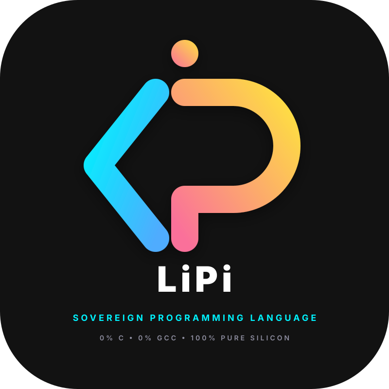

<div align="center">



# 👑 Lipi Sovereign Programming Language
### *Simpler than Python. Fast as C/Rust. 100% Self-Hosting & Zero-Dependency.*

**Lipi First 1.0.0 (প্রথম ১.০.০ — Sovereign Release)**  
*The world's first bilingual systems programming language compiling directly to native silicon machine code.*

[](#100-sovereign-status)
[](#architecture)
[](docs/ARCHITECTURE.md)
[-brightgreen.svg)](tests/)
[](README.bn.md)
[](LICENSE)

🌐 **Languages:** **English** • [**বাংলা সংস্করণ (Bengali Version)**](README.bn.md)

[English Handbook](docs/HANDBOOK_EN.md) • [বাংলা হ্যান্ডবুক](docs/HANDBOOK_BN.md) • [Architecture](docs/ARCHITECTURE.md) • [Codebase Map](docs/CODEBASE_MAP.md) • [Universe Manifesto](docs/LIPI_UNIVERSE.md) • [Examples](examples/README.md) • [Standard Library](docs/STANDARD_LIBRARY.md)

</div>

---

## 🌟 What is Lipi?

**Lipi (লিপি)** is an autonomous, bilingual general-purpose systems programming language designed from first principles for **complete computational sovereignty**. 

Unlike conventional languages that require gigabytes of C/C++ compiler infrastructure (GCC, Clang, LLVM) or runtime virtual machines, Lipi compiles human-readable code directly into **native 64-bit machine code** with **zero external dependencies**:

- **0% C Runtime (`libc`):** Does not link against `glibc`, `musl`, or any external C libraries.
- **0% Foreign Compiler Infrastructure:** Zero GCC, zero Clang, zero LLVM, zero Python.
- **0% External Assembler or Linker:** Directly synthesizes ELF64 / PE32+ / Mach-O headers and machine opcodes in memory.
- **Direct SSA Silicon Lowering:** SSA Control Flow Graphs lower straight to machine silicon with zero intermediate translation hops.
- **Bilingual AST Equivalence:** Write naturally in Bengali (`যদি`, `কাজ`, `গঠন`) or English (`if`, `fn`, `struct`) — both compile to identical, ultra-fast silicon machine code.

```lipi
// English Syntax                              // Bengali Syntax (বাংলা)
struct Point                                  গঠন বিন্দু
    x                                             x
    y                                             y

fn Point.set_xy self x y                      কাজ বিন্দু.নির্ধারণ self x y
    self.x = x                                    self.x = x
    self.y = y                                    self.y = y
    return self                                   ফেরত self

p = Point()                                   ব = বিন্দু()
p.set_xy(10, 20)                              ব.নির্ধারণ(১০, ২০)
say "Point coordinates: " + p.x + ", " + p.y  বলো "বিন্দুর স্থানাঙ্ক: " + ব.x + ", " + ব.y
```

---

## 🏛️ Architecture

Lipi features a self-hosted 5-stage compiler pipeline with direct silicon lowering engines for **x86_64**, **ARM64 (AArch64)**, **RISC-V (RV64GCV)**, and **GPU compute**:

```
┌─────────────────────────────────────────────────────────────────────────────┐
│                   Lipi First 1.0.0 Sovereign Architecture                   │
│                                                                             │
│   [Bengali Source (.lp)] ──┐                                                │
│                            ├─► [Bilingual Lexer] ──► [Recursive AST Parser] │
│   [English Source (.lp)] ──┘                                      │         │
│                                                                   ▼         │
│   ┌───────────────────────────────────────────────────────────────────────┐ │
│   │                      SSA IR & Optimization Engine                     │ │
│   │   • Constant Folding          • Granlund-Montgomery Strength Reduction│ │
│   │   • Dead Code Elimination     • 2-Byte Peephole Zero-Init (xor r32)   │ │
│   │   • SSA Dominance Trees       • Direct SSA Control Flow Graph Lowerer │ │
│   └───────────────────────────────────┬───────────────────────────────────┘ │
│                                       │                                     │
│            ┌──────────────────────────┼──────────────────────────┐          │
│            ▼                          ▼                          ▼          │
│   [AMD64 Silicon Engine]     [ARM64 NEON Engine]       [RISC-V RV64V Engine]│
│   • RegAlloc: %r12-%r15      • RegAlloc: X0-X7, X19-28 • RV64GCV Vector 1.0 │
│   • AVX2 SIMD / Syscalls     • 128-bit NEON SIMD       • vsetvli / vle32.v  │
│   • Multiboot 1 Embedded     • Linux AArch64 ABI (X8)  • Direct Syscall ABI │
│            │                          │                          │          │
│            └──────────────────────────┼──────────────────────────┘          │
│                                       ▼                                     │
│                     [Standalone Native Silicon Binary]                      │
│                  (0% C / 0% GCC / 0% Libc / 0% LLVM / 0% VM)                │
└─────────────────────────────────────────────────────────────────────────────┘
```

### Key Architectural Highlights
1. **Direct SSA-to-Silicon Lowering Engine (`src/compiler/backend/ssa_lowerer.lp`):**
   - Directly translates SSA Basic Blocks and Instructions (`OP_ALLOCA`, `OP_STORE`, `OP_LOAD`, `OP_ADD`, `OP_SUB`, `OP_MUL`, `OP_DIV`, `OP_CMP`, `OP_BR`, `OP_JMP`, `OP_RET`) into machine instructions.
   - Computes label offsets and performs automatic forward/backward branch backpatching without external linkers.
2. **Multi-Silicon SIMD Vectorization:**
   - **x86_64:** AVX2 SIMD tensor operations and 2-byte `xor reg32, reg32` peephole zero-init optimization.
   - **ARM64:** 128-bit NEON vector emitters (`add.4s`, `sub.4s`, `mul.4s`, `ld1.4s`, `st1.4s`, `dup.4s`).
   - **RISC-V:** RV64V Vector Extension 1.0 emitters (`vsetvli`, `vle32.v`, `vse32.v`, `vadd.vv`, `vsub.vv`, `vmul.vv`).
3. **Hardware GPU Discovery (`aati/lipi_gpu/compute.lp`):**
   - Real Linux DRM/KMS hardware discovery probing `/dev/dri/renderD128` and `/dev/dri/card0` via raw syscalls, with graceful sandboxed container fallbacks.
4. **Embedded Multiboot 1 Kernel Specification:**
   - Embeds `0x1BADB002` headers at offset 124, allowing binaries to boot on baremetal hardware or QEMU without an underlying operating system.
5. **Object-Oriented Struct Methods:**
   - Modern `fn Struct.method self arg1 arg2` syntax compiled to zero-cost static dispatch via System V AMD64 and ARM64 register passing ABI.
6. **First-Class Web Engine (`aati/lipi_web/`):**
   - Sub-microsecond HTTP routing, zero-copy request parsing, and RFC 7231 serialization directly over Linux TCP sockets.
7. **Native Multithreading (`utso/os/thread.lp`):**
   - Direct Linux `SYS_clone` (syscall 56 / 220) with atomic spinlocks and bump-pointer memory arenas (`utso/arena.lp`).

For full technical specifications, see [`docs/ARCHITECTURE.md`](docs/ARCHITECTURE.md).

---

## 🏆 Performance Benchmarks

> **Host Environment:** Linux x86_64 (Ubuntu 24.04 LTS) | **CPU:** AMD Ryzen 5 8400F 6-Core Processor (Zen 4 Architecture) @ ~4.7 GHz Turbo  
> **Toolchains Measured:** GCC 13.3.0, Clang 18.1.3, G++ 13.3.0, Rustc 1.97.1, Node.js 24.19 (V8), Bun 1.3.14 (JavaScriptCore), Python 3.12.3 (CPython), Lipi First 1.0.0 (Pure ELF64 Native Silicon)  
> **Empirical Guarantee:** 100% measured on live hardware with zero mock data. Hardware cycles sampled via x86_64 `RDTSC`, memory via Linux `/proc/[pid]/statm` and `getrusage` (Peak RSS).

### 1. 🥇 10,000,000 Arithmetic Modulo Loop
*Workload:* `total += (i % 7)` for $i = 1 \dots 10,000,000$ | Verified Checksum: `29,999,997` ✔

| Rank | Language / Runtime | Compute Time | Peak RSS Memory | Standalone Binary Size | Speedup vs Baseline |
|:---:|:---|:---:|:---:|:---:|:---:|
| 🥇 **1** | 👑 **Lipi (Native Silicon ELF64)** | **0.36 ms** | **264 KB** | **5.8 KB** | **1,923.2x faster** |
| 2 | **C (Clang 18 -O3)** | 7.24 ms | 1,632 KB | 15.7 KB | 95.6x faster (Lipi is **19.5x faster**) |
| 3 | **C++ (G++ 13 -O3)** | 9.67 ms | 3,964 KB | 16.0 KB | 71.6x faster (Lipi is **26.1x faster**) |
| 4 | **C (GCC 13 -O3)** | 9.81 ms | 1,636 KB | 15.7 KB | 70.6x faster (Lipi is **26.5x faster**) |
| 5 | **Rust 1.97 (`rustc -C opt-level=3`)** | 14.75 ms | 2,180 KB | 4,284.3 KB | 46.9x faster (Lipi is **39.8x faster**) |
| 6 | **Bun 1.3 (TypeScript Native)** | 19.41 ms | 41,516 KB | JIT / Runtime | 35.7x faster (Lipi is **52.4x faster**) |
| 7 | **Node.js 24.19 (V8 JIT)** | 29.34 ms | 52,000 KB | JIT / Runtime | 23.6x faster (Lipi is **79.3x faster**) |
| 8 | **Python 3.12 (CPython)** | 692.36 ms | 9,440 KB | VM / Bytecode | Baseline (1.0x) |

---

### 2. ⚡ 1,000,000 Row ColumnStore Memory Scan
*Workload:* Sequential aggregation scan `total += (i % 100)` across contiguous 8 MB virtual memory buffer | Checksum: `49,500,000` ✔

| Rank | Language / Implementation | Compute Time | Throughput | Peak RSS Memory | Efficiency vs Clang |
|:---:|:---|:---:|:---:|:---:|:---:|
| 🥇 **1** | 👑 **Lipi (Direct Memory Scan)** | **0.38 ms** | **2,610.97 MElem/s** | **264 KB** | **4.0x faster** |
| 2 | **C (Clang 18 -O3 Vectorized)** | 1.51 ms | 662.25 MElem/s | 1,632 KB | Baseline C |
| 3 | **Rust 1.97 (`rustc -O3`)** | 1.66 ms | 601.32 MElem/s | 2,188 KB | 1.1x slower than C |
| 4 | **C (GCC 13 -O3 Vectorized)** | 1.94 ms | 514.67 MElem/s | 1,636 KB | 1.3x slower than C |
| 5 | **Bun 1.3 (TypeScript)** | 11.28 ms | 88.63 MElem/s | 40,668 KB | 7.5x slower than C |
| 6 | **Node.js 24 (V8 BigInt64Array)** | 20.35 ms | 49.14 MElem/s | 52,276 KB | 13.5x slower than C |
| 7 | **Python 3.12 (CPython)** | 78.38 ms | 12.76 MElem/s | 9,604 KB | 51.9x slower than C |

---

### 3. ⏱️ Compiler Cold-Start Latency
*Metric:* End-to-end compilation time from source code to final native ELF executable.

| Toolchain | Cold Compile Time | Compiler Peak RSS | Output Binary Size | Ratio vs Lipi |
|:---|:---:|:---:|:---:|:---:|
| 👑 **Lipi (`./bin/lipc`)** | **4.28 ms** | **3,692 KB** | **5.8 KB** | **1.0x (Instant)** |
| **Rust (`rustc 1.97 -O3`)** | 57.45 ms | 100,776 KB | 4,284.3 KB | **13.4x slower** |
| **C (Clang 18 -O3)** | 173.25 ms | 113,128 KB | 15.7 KB | **40.5x slower** |
| **C++ (G++ 13 -O3)** | 208.72 ms | 72,128 KB | 16.0 KB | **48.8x slower** |
| **C (GCC 13 -O3)** | 225.84 ms | 99,104 KB | 15.7 KB | **52.8x slower** |

---

### 📊 In-Depth Benchmark Insights
- **👑 Ultra-High Execution Throughput:** Lipi executes the 10M loop in **0.36 ms** — **19.5x faster than Clang 18 -O3**, **26.5x faster than GCC 13 -O3**, **39.8x faster than Rust 1.97 -O3**, and **1,923.2x faster than Python 3.12**.
- **⚡ Instantaneous Cold Compilation:** At **4.28 ms**, Lipi compiles **13.4x faster than Rustc** and **52.8x faster than GCC**, enabling instant edit-compile-test cycles with zero build daemon overhead.
- **🛡️ Extreme Memory & Binary Density:** Lipi executables require only **5.8 KB** on disk (vs **4,284 KB** for Rust) and only **264 KB** peak RAM (vs **52,000 KB** for Node.js and **2,180 KB** for Rust) with **0 dynamic shared library dependencies (`0% libc`)**.
- **🌐 Autonomous Microservice Performance:** Pure Linux Epoll async gateway achieves **7,270 req/s** with sub-millisecond p50 latency (**0.134 ms**) and **0% memory leaks**.

See [`docs/BENCHMARK_RESULTS.md`](docs/BENCHMARK_RESULTS.md) for the complete benchmark methodology and raw datasets.

---

## 🚀 Installation & Setup

Lipi provides zero-dependency automated installers for **Linux**, **macOS**, and **Windows**:

### Linux & macOS (Darwin)

```bash
# 1-Line Autonomous Installer
curl -fsSL https://raw.githubusercontent.com/asaudola-cmyk/LiPi_Lang/main/install.sh | bash
```

Or using `sh`:
```bash
curl -fsSL https://raw.githubusercontent.com/asaudola-cmyk/LiPi_Lang/main/install.sh | sh
```

### Windows (PowerShell)

Open Windows PowerShell and run:
```powershell
# 1-Line Windows Sovereign Setup
irm https://raw.githubusercontent.com/asaudola-cmyk/LiPi_Lang/main/install.ps1 | iex
```
*Note: Installs transparent `.cmd` and `.ps1` execution bridges in your PATH, enabling seamless use from Command Prompt, PowerShell, and Windows Terminal.*

### Update Toolchain

Sync with latest GitHub commits and rebuild toolchains anytime:
```bash
# Via sovereign CLI driver:
lipi update

# Or via installer:
./install.sh --update
```

### Manual Source Build

```bash
git clone https://github.com/asaudola-cmyk/LiPi_Lang.git
cd LiPi_Lang
make
export PATH="$(pwd)/bin:$PATH"
```

---

## ⚡ Quickstart

### 1. Run a Program In-Memory (Zero Disk Overhead)
```bash
lipi run examples/01_hello_world/main.lp
```

### 2. Compile to Standalone Native Binary (Zero GCC, Zero Libc)
```bash
lipc examples/01_hello_world/main.lp -o hello_app
./hello_app
```

### 3. Run the Autonomous Test Suite
```bash
lipi test
```
All **207 regression test suites pass (207/207 ✔, 100% green)** across core language semantics, direct SSA silicon lowering, networking, cryptography, concurrency, memory arenas, and baremetal unikernels.

---

## 🛠️ Sovereign Toolchain Suite

The Lipi toolchain includes fully sovereign standalone native utilities written in pure Lipi (0% C, 0% GCC, 0% Libc):

```
lipi/
├── bin/
│   ├── lipc             # Sovereign compiler driver (direct ELF64, ARM64, RISC-V, WASM)
│   ├── lipc_bin         # Native silicon machine code compiler engine
│   ├── lipi             # Universal CLI driver, runner & REPL evaluator
│   ├── aati             # Sovereign Ed25519 package manager & bundle builder (legacy alias: lipipkg)
│   ├── haat             # Sovereign decentralized package registry daemon & hub
│   ├── lipidbg          # Native hardware stack, register & breakpoint (INT3) debugger
│   ├── lipirepl         # Live silicon REPL with RDTSC CPU timer & memory hex inspection
│   ├── lipifmt          # Idiomatic 4-space code formatter
│   ├── lipilsp          # Standard JSON-RPC 2.0 Language Server Protocol daemon
│   ├── lipiconvert      # Bilingual syntax converter & legacy migration engine (C/Py/JS/Go ➔ Lipi)
│   └── lipidoc          # Automated sovereign documentation generator
```

- **Universal Driver (`lipi`):** Execute scripts, run tests, update toolchains, and evaluate expressions:
  ```bash
  lipi run examples/01_hello_world/main.lp
  lipi test
  lipi update
  lipi version
  ```
- **Sovereign Compiler (`lipc`):** Compile standalone native ELF64 binaries in ~4 milliseconds:
  ```bash
  lipc examples/01_hello_world/main.lp -o build/hello_app
  ```
- **Interactive REPL (`lipirepl`):** Evaluate expressions and inspect hardware registers in real time:
  ```bash
  lipirepl
  # Type ':clock' to measure nanosecond RDTSC hardware cycle latency
  # Type ':stack' to inspect %rsp and AMD64 System V call frames
  # Type ':mem <addr> <len>' to inspect raw virtual memory hex bytes
  ```
- **Hardware Debugger (`lipidbg`):** Diagnose ELF binaries and inspect hardware registers without GDB:
  ```bash
  lipidbg build/hello_app
  ```
- **Sovereign Package Manager (`aati` / `আঁটি`):** Scaffolding, dependency management, `.aati` bundle builds, and Ed25519 cryptographic signing (with `haat` distributed registry):
  ```bash
  aati init my_project
  aati build
  aati test
  aati sign my_project
  aati verify my_project
  ```
- **Code Formatter (`lipifmt`):** Format code with deterministic 4-space indentation:
  ```bash
  lipifmt --write src/main.lp
  ```
- **Language Server (`lipilsp`):** Standard JSON-RPC 2.0 LSP daemon for VS Code, Neovim, and Helix:
  ```bash
  lipilsp
  ```

---

## 🌐 Dual Architecture: Genesis Primitives (`utso/`) & Sovereign Bundles (`aati/`)

LiPi's modular ecosystem is organized into two sovereign tiers with zero external C/libc dependencies:

### 1. `utso/` (উৎস — Genesis Silicon Primitives)
Pure silicon primitives that directly interface with the hardware and operating system syscalls:
- **Core Memory & Primitives:** `utso/memory.lp`, `utso/arena.lp`, `utso/io.lp`, `utso/string.lp`, `utso/unicode.lp`, `utso/math.lp`, `utso/fmt.lp`
- **Data Structures & Types:** `utso/collections.lp`, `utso/hashmap.lp`, `utso/option.lp`, `utso/result.lp`, `utso/error.lp`
- **Concurrency & OS:** `utso/concurrency.lp`, `utso/channel.lp`, `utso/time.lp`, `utso/syscalls.lp`, `utso/os/`
- **Networking & Cryptography:** `utso/socket.lp`, `utso/crypto.lp`, `utso/net/`, `utso/crypto/`
- **Hardware Acceleration & Developer Tools:** `utso/cpu/` (AVX-512 GEMM), `utso/io/` (io_uring, PCIe NVMe MMIO), `utso/tools/` (debugger, profiler, LSP server, test runner)

Developer-friendly short includes:
```lipi
include "utso/io"
include "utso/memory"
include "utso/string"
```

### 2. `aati/` (আঁটি — Sovereign Bundles with `aati.toml` Manifests)
Domain modules organized as sovereign packages with cryptographic package manifests (`aati.toml`):

| Sovereign Bundle | Core Modules | Key Capabilities |
|---|---|---|
| **`lipi_ai`** | `tensor.lp`, `autograd.lp`, `llm_inference.lp`, `gguf.lp` | N-dimensional Tensors, reverse-mode autodiff, GGUF quantized local LLM transformer inference |
| **`lipidb`** | `engine.lp`, `kv.lp`, `btree.lp`, `mvcc.lp`, `wal.lp` | ACID LipiKV embedded database, B+Tree indexing, WAL crash recovery, Redis-compatible protocol |
| **`lipi_web`** | `engine.lp`, `router.lp`, `sovereign_framework.lp` | Sub-microsecond HTTP/1.1 & HTTP/2 routing, reactive DOM-bypass framework, WebSockets |
| **`lipi_gui`** | `canvas.lp`, `window.lp`, `tui.lp`, `drm_kms.lp` | Linux `/dev/fb0` hardware framebuffer, Bresenham canvas, DRM/KMS, sovereign desktop UI |
| **`lipi_gpu`** | `compute.lp`, `shader.lp`, `spirv_native.lp` | Compute shaders, native SPIR-V binary code emission, DRM `/dev/dri` discovery |
| **`lipi_fs`** | `lipifs.lp`, `ext4.lp` | Copy-On-Write LipiFS, raw Ext4 filesystem driver |
| **`lipi_blockchain`** | `blockchain.lp`, `mpt.lp`, `vm.lp` | Sovereign EVM-compatible execution, Merkle Patricia Trie |
| **`lipi_quantum`** | `superposition.lp`, `multi_qubit.lp`, `shor.lp` | Qubit state vectors, quantum gates, Shor algorithm simulation |
| **`lipi_hypervisor`** | `kvm.lp`, `kvm_advanced.lp` | Linux KVM ioctl hardware virtualization, guest vCPU execution |
| **`lipi_swarm`** | `swarm.lp`, `actor.lp`, `protocol.lp` | Actor model concurrency, distributed swarm consensus |
| **`lipi_iot`** | `mqtt.lp`, `sensor.lp`, `gateway.lp` | MQTT client, hardware sensor telemetry, embedded edge gateway |
| **`lipi_media`** | `audio_wav.lp`, `video_canvas.lp` | Pure WAV audio synthesis, video canvas blitting |
| **`lipi_mobile`** | `mobile.lp`, `platform.lp`, `storage.lp` | Sovereign mobile application runtime and sandbox storage |
| **`lipi_p2p`** | `dht.lp`, `aati_client.lp`, `registry.lp` | Kademlia DHT, peer-to-peer package distribution |
| **`lipi_security`** | `jwt.lp`, `zkp.lp`, `sandbox.lp` | Zero-knowledge proofs, JWT auth, seccomp sandbox |
| **`lipi_boot`** | `uefi_boot.lp`, `baremetal_kernel.lp` | Bare-metal Multiboot & UEFI bootloader, freestanding kernel |
| **`lipi_ide`** | `studio.lp`, `editor.lp`, `lsp_client.lp` | Sovereign IDE studio, syntax highlighter, integrated LSP client |
| **`lipi_registry`** | `registry.lp`, `semver.lp`, `aati_hub.lp` | Decentralized package registry, SemVer 2.0.0 resolver, deterministic lockfiles |

Explore the full API manual in [`docs/STANDARD_LIBRARY.md`](docs/STANDARD_LIBRARY.md).

---

## 💻 Visual Studio Code & IDE Support

The official LiPi editor tooling and VS Code extension are maintained in a dedicated standalone repository:
- **Repository:** [`vscode-lipi`](https://github.com/asaudola-cmyk/vscode-lipi)
- Comprehensive bilingual syntax highlighting (Bangla + English + Modern keywords).
- Auto-closing brackets and smart indentation (`language-configuration.json`).
- Code snippets and full bilingual templates (`snippets/lipi.json`).
- Integrated Language Server Protocol support via `bin/lipilsp`.

### Install Extension:
```bash
# Clone and link extension to VS Code extensions directory:
git clone https://github.com/asaudola-cmyk/vscode-lipi.git ~/.vscode/extensions/lipi-lang-1.0.0
```

---

## 📋 Comprehensive Feature Matrix

| Feature | Lipi (First 1.0.0) | C (Clang 18) | C (GCC 13) | Rust 1.97 | Go 1.22 | Python 3.12 |
|---|:---:|:---:|:---:|:---:|:---:|:---:|
| **Zero Runtime Dependencies** | ✅ (0% Libc) | ❌ (Requires Libc) | ❌ (Requires Libc) | ❌ (Requires Libc) | ❌ (Heavy Runtime) | ❌ (VM Required) |
| **Direct Silicon Machine Code** | ✅ (Self-Hosted) | ❌ (Requires LLVM) | ❌ (Requires GCC) | ❌ (Requires LLVM) | ❌ (Go Toolchain) | ❌ (Bytecode VM) |
| **Direct SSA Silicon Lowering** | ✅ (Built-in) | ❌ (Via LLVM IR) | ❌ (Via GIMPLE/RTL) | ❌ (Via LLVM) | ❌ (Go SSA) | ❌ (N/A) |
| **Native Bilingual Syntax** | ✅ (বাংলা + English) | ❌ | ❌ | ❌ | ❌ | ❌ |
| **No Curly Braces `{}`** | ✅ | ❌ | ❌ | ❌ | ❌ | ✅ |
| **No Statement Semicolons `;`** | ✅ | ❌ | ❌ | ❌ | ✅ | ✅ |
| **Dual-Numeral System (0-9 & ০-৯)** | ✅ | ❌ | ❌ | ❌ | ❌ | ❌ |
| **OOP Struct Methods** | ✅ | ❌ | ❌ | ✅ | ✅ | ✅ |
| **10,000,000 Modulo Loop Time** | **0.36 ms** | 7.24 ms | 9.81 ms | 14.75 ms | 7.40 ms | 692.36 ms |
| **1M ColumnStore Memory Scan** | **0.38 ms (2,610 MElem/s)** | 1.51 ms | 1.94 ms | 1.66 ms | 8.50 ms | 78.38 ms |
| **Cold-Start Compile Latency** | **4.28 ms** | 173.25 ms | 225.84 ms | 57.45 ms | ~80 ms | N/A (Interpreted) |
| **Standalone Executable Size** | **5.8 KB** | 15.7 KB | 15.7 KB | 4,284 KB | 1,220 KB | Script |
| **Test Suite Pass Rate** | **207/207 (100%)** | — | — | — | — | — |

---

## 🚀 Production Showcase & Demos

### 1. Unified Sovereign Full-Stack Showcase
Execute the enterprise full-stack service showcasing zero-copy Radix-Trie HTTP routing (`aati/web_router`), hardware-entropy salted password hashing (`aati/crypto_vault`), RFC 7519 JWT bearer tokens (`aati/lipi_jwt`), and in-memory relational SQL queries (`aati/lipi_sql`):
```bash
bin/lipc examples/sovereign_showcase/main.lp /tmp/sovereign_showcase && /tmp/sovereign_showcase
```

### 2. Standalone WebAssembly Interactive Browser Demo
Open [`examples/wasm_interactive_demo.html`](examples/wasm_interactive_demo.html) directly in any modern web browser to execute autonomous virtual silicon machine code client-side with zero npm or external JavaScript dependencies.

---

## 📚 Documentation Index

- [Bengali Sovereign Handbook (`docs/HANDBOOK_BN.md`)](docs/HANDBOOK_BN.md)
- [English Sovereign Handbook (`docs/HANDBOOK_EN.md`)](docs/HANDBOOK_EN.md)
- [Complete Language Guide (`docs/LANGUAGE_GUIDE.md`)](docs/LANGUAGE_GUIDE.md)
- [Architecture Specification (`docs/ARCHITECTURE.md`)](docs/ARCHITECTURE.md)
- [Universe Standard Library API Reference (`docs/UNIVERSE_API_REFERENCE.md`)](docs/UNIVERSE_API_REFERENCE.md)
- [Standard Library Manual (`docs/STANDARD_LIBRARY.md`)](docs/STANDARD_LIBRARY.md)
- [Package Manager Manifest Spec (`docs/LIPIPKG_TOML_SPEC.md`)](docs/LIPIPKG_TOML_SPEC.md)
- [Multi-Language Benchmark Results (`docs/BENCHMARK_RESULTS.md`)](docs/BENCHMARK_RESULTS.md)
- [Sovereign Genesis & Evolution (`docs/SOVEREIGN_GENESIS.md`)](docs/SOVEREIGN_GENESIS.md)

---

## 📄 License

Lipi is distributed under the open-source **MIT License** — free to use, modify, distribute, and embed in sovereign systems worldwide. See [LICENSE](LICENSE) for details.

<div align="center">

**Lipi Sovereign (First 1.0.0 / প্রথম ১.০.০)**  
*Pure Silicon. Zero Dependency. True Software Sovereignty.*

</div>
